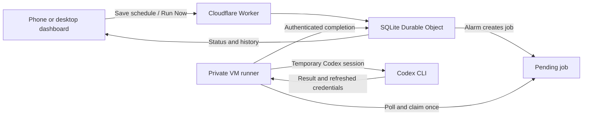

<div align="center">
  
  <h1>Codex Prewarmer</h1>
  <p>Schedule a small Codex request. Manage it from your phone. Run it on infrastructure you control.</p>
  <p>
    <a href="LICENSE"></a>
    
    
    
  </p>
  <p><a href="#quick-start">Quick start</a> · <a href="#how-it-works">How it works</a> · <a href="docs/DEPLOYMENT.md">Self-hosting</a> · <a href="CONTRIBUTING.md">Contributing</a></p>
</div>

Codex Prewarmer is an unofficial, self-hosted scheduler with a mobile-friendly dashboard. Choose recurring weekdays and an IST time, run a request manually, and inspect its result. Cloudflare keeps the schedule; an isolated runner executes the request even when your phone app and laptop are closed.

**The quota-window effect is unproven.** A successful request confirms execution; it does not establish that a five-hour usage window started or reset. This project does not bypass limits, restore quota, or guarantee request timing. Real execution uses your account's allowance and requires you to configure and enable it explicitly.

## What you get

| Feature                | Behavior                                                                                             |
| ---------------------- | ---------------------------------------------------------------------------------------------------- |
| Weekly schedules       | Select multiple weekdays and a time in **Asia/Kolkata / IST**; edit, enable, disable or delete them. |
| Run Now                | Submit a manual job through the same protected execution path.                                       |
| Status and history     | See the next scheduled occurrence, runner availability and recorded run outcomes.                    |
| Mobile PWA             | Responsive navigation and install support on compatible Android browsers over HTTPS.                 |
| Durable scheduling     | SQLite-backed Cloudflare Durable Object storage, alarms and persistent job identifiers.              |
| Isolated execution     | A serialized Linux VM runner with a temporary Codex home and protected service credentials.          |
| Account handling       | Encrypted stored credentials, refresh write-back and explicit reconnect states.                      |
| Safe local development | Mock execution and generated local secrets; no Codex account is needed to try the app.               |

## Quick start

Use **Node.js 22** and **npm 10**. The pinned development version is in [`.nvmrc`](.nvmrc).

```sh
git clone https://github.com/Niru-26016/codex-prewarmer-open-source.git
cd codex-prewarmer-open-source
npm ci
npm run local:setup
npm run types
npm start
```

Open **http://127.0.0.1:8787**. Open the generated `.dev.vars` file locally and use its `ADMIN_PASSWORD` to unlock the dashboard. Keep that file private; it is ignored by Git.

The local app uses mock jobs. Try creating a schedule, pressing **Run Now**, and inspecting **History**. No cloud deployment, real account connection or model request is required. The loopback server is accessible on your development computer; installing on a phone requires an HTTPS deployment.

The setup script preserves an existing `.dev.vars` file. Start from [`.env.example`](.env.example) when provisioning a separate environment; generate distinct values rather than reusing test literals or development secrets.

## How it works



1. Saving a schedule persists its selected weekdays and IST time and arms the next server-side alarm.
2. The alarm creates a job and calculates the next occurrence. The phone does not need to remain open.
3. While idle, the VM runner checks for work approximately every ten seconds and claims a specific job once.
4. For an explicitly enabled live job, it uses a temporary authentication directory and starts Codex with `--ephemeral`, asking: **“Reply with the single word OK.”** It does not open a normal ChatGPT browser chat or continue an existing conversation.
5. Completion updates the history, stores any refreshed credentials encrypted and removes the temporary directory. The runner returns to waiting.

The timer in the dashboard is the next **scheduled request**, not a verified quota-reset timer. Overlapping scheduled jobs are skipped rather than executed in parallel. See [architecture and failure behavior](docs/ARCHITECTURE.md).

## Self-hosting

The application has two independently operated parts:

- **Cloudflare Worker and SQLite Durable Object:** hosts the PWA, authenticates access, stores state and coordinates alarms.
- **Runner:** a private Linux x86_64 VM using systemd, or the separately configured Cloud Run adapter. The VM connects outbound over HTTPS and does not require a public application port.

Start with [the deployment guide](docs/DEPLOYMENT.md), then follow [the VM runner guide](docs/VM_RUNNER.md). [Cloud Run](docs/CLOUD_RUN.md) is an alternative with separate IAM, container and billing requirements.

Every shipped environment keeps `DRY_RUN=true`, `ENABLE_LIVE_RUNS=false` and `ALLOW_CODEX_CONNECTION=false`. Local development uses `EXECUTOR=mock`; the VM and Cloud Run configurations select their respective adapters but remain disabled for real account activity. Use your own Worker names and HTTPS origins.

Deploy and verify mock behavior before connecting an account. Live operation requires matching Worker and runner gates, a ready account connection and a protected runner credential. Store credentials in the platform's secret storage and root-only runner configuration, never in the repository, container image, command arguments or CI artifacts. The detailed procedure and recovery boundaries are in [security and recovery](docs/SECURITY.md).

You control cloud access and costs. Review the services' current pricing and account terms before provisioning resources. GitHub Actions is for building and testing this project; it is not a recurring account-request runner.

## Development and verification

```sh
npm run types
npm run check
npx playwright install chromium
npm run test:e2e
```

Full verification also requires **Python 3.8+** for the installer checks.

`check` runs formatting, lint, TypeScript, Node tests, local workerd/SQLite tests, Python installer checks, the production frontend build and a staging deployment **dry-run**. It does not publish a Worker. Browser tests use a separate local mock server with synthetic credentials.

Useful commands:

| Command                           | Purpose                                               |
| --------------------------------- | ----------------------------------------------------- |
| `npm start`                       | Build and serve the complete app locally.             |
| `npm run dev`                     | Start the Vite frontend development server.           |
| `npm run test:unit`               | Run Node unit tests.                                  |
| `npm run test:worker`             | Exercise Worker and SQLite behavior in local workerd. |
| `npm run test:e2e`                | Run browser tests, including a mobile viewport.       |
| `npm run deploy:check:vm`         | Bundle the VM environment without deploying.          |
| `npm run deploy:check:production` | Bundle the Cloud Run environment without deploying.   |

The included Actions workflow runs on pushes to `main`, pull requests and manual dispatch, using fake test credentials. See [the verification guide](docs/TEST_REPORT.md) for test scope and the distinction between local checks and live deployment proof.

## Project map

```text
web/          React dashboard, styles and PWA assets
src/          Worker routes, persistent state, scheduling and security
scripts/      Local setup, connection helper, runner and release packaging
infra/        VM service, installer and Cloud Run job template
runner/       Pinned runtime dependencies and container definition
tests/        Node and local Worker tests
e2e/          Browser and mobile-viewport tests
docs/         Architecture, deployment, API and security documentation
```

## Boundaries to understand

- This is a **single-owner application**, not a hosted multi-user service.
- Schedules currently use **IST only**. Installing the PWA does not create an Android system alarm or add push notifications.
- Cloud alarms, connectivity and runner polling can introduce delays. A single VM is a single availability dependency.
- A job can fail after a request was accepted externally. The app uses claims and credential quarantine to avoid blindly replaying uncertain live work; it cannot promise exactly-once inference.
- Infrastructure administrators can access credentials their infrastructure must decrypt. Review the [trust model](docs/SECURITY.md) before connecting an account.
- Local tests and mock jobs do not prove real authentication, physical-device installation, cloud availability or quota-window behavior.

## Contributing

Bug reports, documentation improvements and focused pull requests are welcome. Read [CONTRIBUTING.md](CONTRIBUTING.md) for the workflow and [SECURITY.md](SECURITY.md) for responsible reporting. Never attach real account credentials or private deployment logs to an issue.

## License and attribution

Project source is released under the [MIT License](LICENSE). Dependencies and downloaded runtime tools retain their own licenses; inspect their distributions before redistributing them. The VM packaging script downloads pinned third-party tools separately rather than committing their binaries here.

`"private": true` in `package.json` prevents accidental npm publication; it does not change this repository's MIT license.

Codex, ChatGPT, OpenAI and Cloudflare are names of their respective owners. This is an independent project and is not affiliated with or endorsed by OpenAI or Cloudflare.
