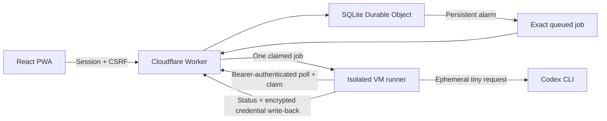

# Architecture

Prewarmer separates the phone interface, persistent scheduling and execution host. It is a single-owner application, not a multi-tenant account service.

Cloud Run is an optional alternative to the VM service. Each job container receives an immutable job ID. GitHub Actions only builds and tests the repository; it is not an execution scheduler.

## Components

| Path                    | Responsibility                                                                                          |
| ----------------------- | ------------------------------------------------------------------------------------------------------- |
| `web/`                  | Responsive React dashboard, weekly schedule editor, status/history, install manifest and service worker |
| `src/worker.ts`         | Same-origin HTTP API, session/CSRF/runner authorization and bounded request parsing                     |
| `src/state.ts`          | Serialized job and credential state machine, alarms, dispatch, claims and completion                    |
| `src/store.ts`          | SQLite persistence, schema migrations, schedules, jobs, sessions and deduplication records              |
| `src/schedule.js`       | Weekly IST calendar calculations using a fixed UTC+05:30 offset                                         |
| `scripts/runner.mjs`    | Bound job claim, isolated Codex process, credential write-back and cleanup                              |
| `scripts/vm-runner.mjs` | Sequential polling daemon with graceful main-process drain                                              |
| `src/executors.js`      | Optional Cloud Run API dispatch adapter                                                                 |
| `infra/`                | Reviewed host-service installer and optional job-container template                                     |

## Schedule lifecycle

Saving a schedule computes the next selected weekday/time in IST and persists it. The object rearms its single Cloudflare alarm to the earliest schedule, dispatch or timeout deadline. The phone does not supply background timing and may be closed.

An alarm records its occurrence before dispatch and immediately computes the next recurrence. Occurrence keys make duplicate alarm delivery safe. The object persists skipped occurrences when more than five minutes late, when another job is active or when live credentials are unavailable. Paused schedules have no next occurrence; editing or deleting a schedule rearms the object.

The VM checks for work approximately every ten seconds while idle. Polling returns an exact eligible job ID and updates a heartbeat; it never returns account credentials. A subsequent single-use claim authenticates that job and retrieves its credentials only if current live gates permit it. One active job per owner serializes account refresh and execution.

## Execution and completion

The runner writes authentication to a fresh private temporary home, launches `codex exec --ephemeral` in a read-only sandbox and asks it to reply with the word OK. It ignores ordinary user configuration and rules. Success requires a clean process exit and an OK response. The process group is killed after two minutes if it does not finish.

The runner reads any updated account authentication and sends an authenticated completion callback. The Worker validates credential version and claim token, then atomically stores encrypted credentials and terminal job status. Duplicate identical callbacks return the existing receipt. The runner retries completion delivery, not the model request, then removes its temporary files.

A missing or uncertain live write-back quarantines credentials. A fresh login does not prove an old process has ended; recovery must inspect the external execution before reconnecting. There is no exactly-once guarantee for inference already accepted by an external provider.

## Public defaults and trust

All shipped deployments have live requests and account connection disabled. Local and staging mock runs require no account. The VM dry-run path can verify polling, claims and completion without starting Codex inference. Credentials in automated tests are synthetic.

Account material is encrypted in Worker-controlled storage, with the encryption key held as a separate Worker secret. A compromised Worker or authorized runner can access live credentials; encryption does not protect against the infrastructure owner. This model requires trusted private compute and restricted deploy access.

The countdown represents the next configured request. Successful execution does not prove that a five-hour usage window started, moved or reset. See [deployment](DEPLOYMENT.md), [the API](API.md) and [security](SECURITY.md).
